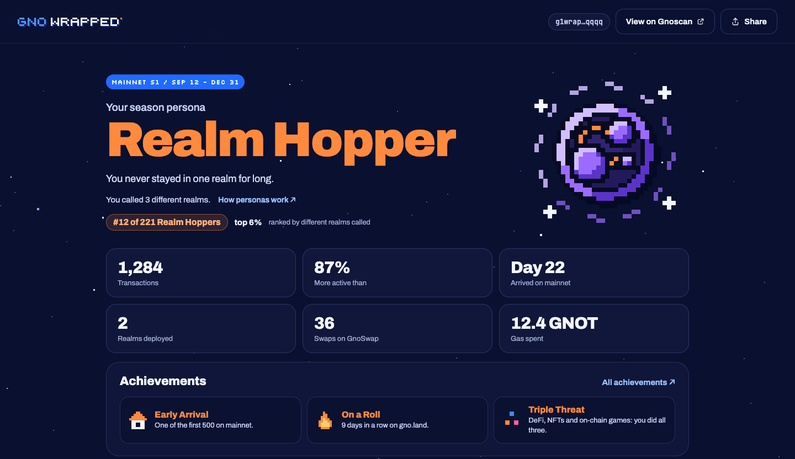
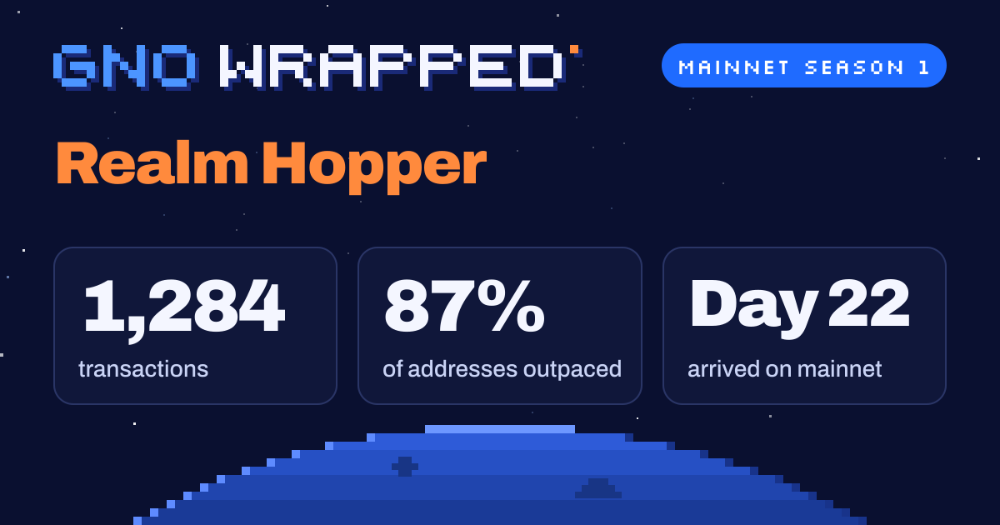
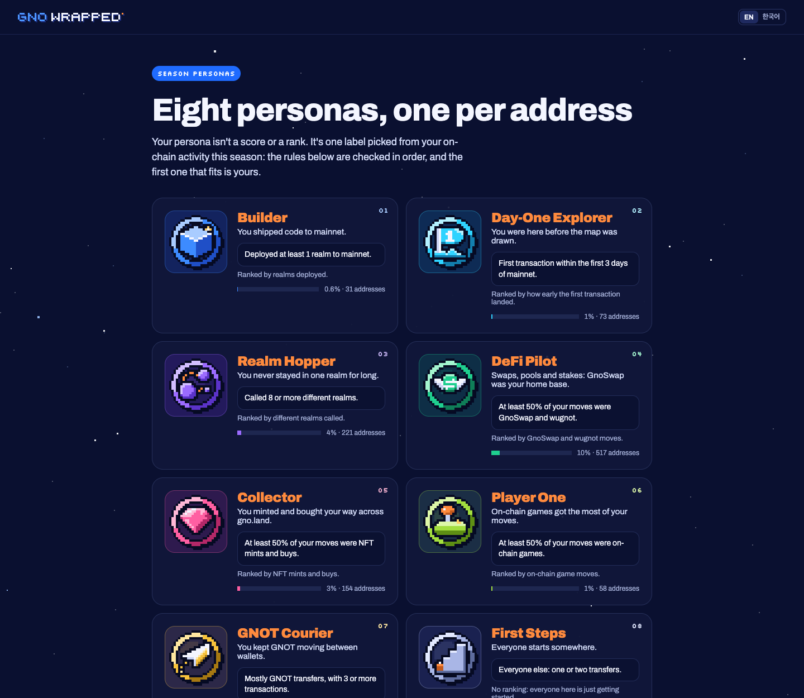
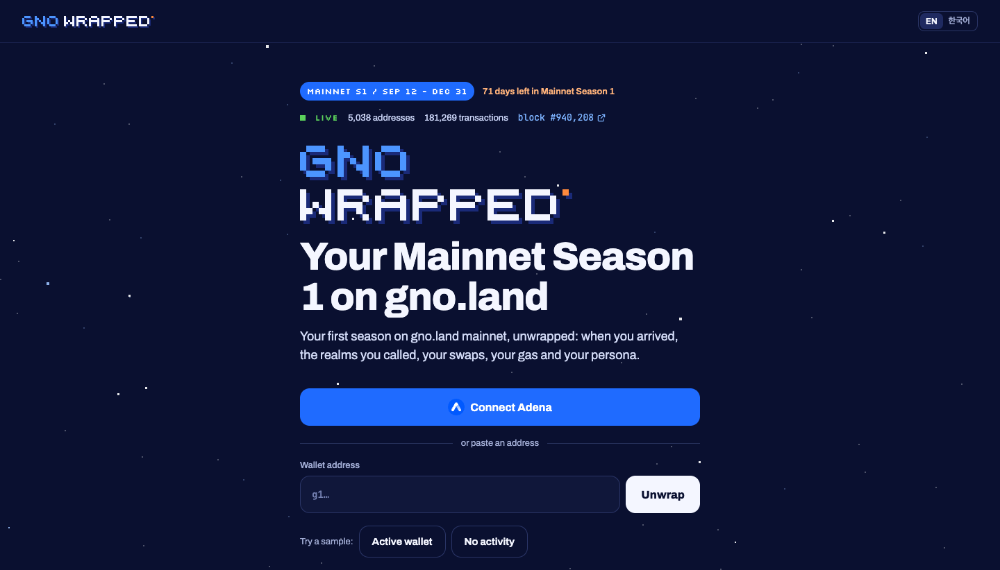

# Gno Wrapped

**Your Mainnet Season 1 on [gno.land](https://gno.land), unwrapped.**

Paste a `g1…` address (or connect [Adena](https://adena.app)) and get a recap of the season:
when you arrived, the realms you called, your swaps and gas, a season persona, achievements,
and a share card for X and Discord. It follows the chain live, so new activity shows up within seconds.

**Try it: [gnowrapped.wookjin.cloud](https://gnowrapped.wookjin.cloud)**



## What's in a recap

- **Season persona**: one of eight (Builder, Day-One Explorer, Realm Hopper, DeFi Pilot, Collector,
  Player One, GNOT Courier, First Steps), picked by rules checked in order, with the reason in your
  own numbers and your rank among others with the same persona.
- **Achievements**: Early Arrival, Realm Pioneer (among the first 10 to call a realm that 50+
  addresses use), On a Roll, Triple Threat, Century, Validators' Friend, Gas Saver.
- **Arrival**: your mainnet day, your place in arrival order, and a season timeline
  (first transaction, first swap, first NFT, first realm deployed, 100th transaction).
- **Activity**: transactions and percentile, a day-by-day calendar with your longest streak (click a day
  to page through its first 100 transactions, each linked to Gnoscan), top realms,
  GnoSwap swaps by week, realms deployed, gas.
- **Since your last visit**: what changed since you last opened your recap (new transactions,
  achievements, rank). The comparison is kept in your browser only.
- **Sharing**: a post for X / Discord, a 1200×630 preview card, and a 1080×1920 image download.
  Once the season is over they say it's the final recap; until then the site counts down the days left.
- **Compare**: paste a friend's share link to see both recaps side by side (`/s1/compare/<id>/<id>`).
  It uses the share views only, so neither address appears.
- **Links out**: your account, first transaction and realms on [Gnoscan](https://gnoscan.io).

<p align="center"></p>

The site's `/season` page is the same recap for the whole chain: totals, transactions and new
addresses per day, and the most-used realms.

Every chart reads out the day (or week) under the pointer or the arrow keys, and has a Table view
that shows the same numbers in the chart's place.

How personas and achievements are decided is on the site's `/personas` page and in
[`batch/build.go`](batch/build.go) and [`batch/achievements.go`](batch/achievements.go).



## Privacy

All data is public on-chain data. Share links still never carry the address:

- Each address gets a random share ID (`/s1/s/<id>`). IDs are random, not derived from the address,
  so the code being public doesn't let anyone map an ID back to an address.
- Behind a share link the batch serves a redacted recap: no address in any form (the short
  `g1xxxx…xxxx` form alone identifies an address), no transaction hash, no exact arrival order,
  and realm paths that contain the address are masked. The calendar shows only active days per week
  (a day-by-day pattern can be matched against the chain) and has no day list (transaction hashes lead
  to the address), and Realm Pioneer doesn't say which realms.
  The share card and image never show the address either.
- Persona ranks are shown only on the owner's own recap. There is no public leaderboard.

Exact stats are still derived from public data, so a determined person could match a shared recap
against the chain. Share links prevent casual exposure; they don't make a recap anonymous.

## How it works

```
                 ┌──────────── HTTP catch-up ────────────┐
tx-indexer ──────┤                                        ├──▶ batch (ingest) ──▶ data/out ──▶ api ──▶ web ──▶ browser
 (gnoland-1)     └──── GraphQL WebSocket subscription ────┘
```

- **batch** (Go) catches up with range queries, then follows new blocks over the
  [tx-indexer](https://github.com/gnolang/tx-indexer)'s GraphQL subscriptions. It applies a block once
  all of its transactions have arrived, rewrites changed per-address JSON every couple of seconds, and
  refills any gap (dropped connection, incomplete block) with range queries. Users never hit the indexer.
- Every range is checked against its blocks' tx counts before it's cached (an incomplete answer is
  retried, never stored). On start, and when a check every 10 minutes finds the cache's tx count
  differing from the chain's `total_txs`, the batch verifies every cached chunk and fetches again the
  ones that don't add up.
- When the chain passes the season's last day, recaps are marked final and dated that day; earlier
  seasons' output stays in `data/out/<season>/`.
- **api** (Go) serves the batch output read-only and reloads a file when the batch rewrites it.
- **web** (Next.js) renders the recap, `/personas`, `/season`, share links and the preview card, reading only the api.

The indexer has no address index: any filter other than block height or transaction hash scans every
transaction. The batch only ever queries by height range.

## Run it

Requires Docker.

```sh
cp .env.example .env                          # optional: every setting has a default
docker compose up -d --build ingest api web   # live batch, api on :8080, web on :3000
docker compose logs -f ingest                 # follow the chain
```

Open http://localhost:3000. The first start fetches the whole season from the indexer
(about 180 range queries, a few minutes, ~20 MB); after that only new blocks.



Set `SHARE_BASE_URL` in `.env` to the public origin used in share links and preview cards, then
rebuild the web image (`docker compose up -d --build web`).

Back up `data/share-ids.json`: share links depend on it, and it can't be regenerated.

### One-off batch commands

```sh
docker compose run --rm batch stats    # distributions for tuning persona and bot rules (read-only)
docker compose stop ingest && docker compose run --rm batch build   # rebuild data/out from the cache
docker compose stop ingest && docker compose run --rm batch verify  # check the cache against the chain, repair, rebuild
```

`fetch`, `verify`, `build` and `all` take a lock on the data directory, so they refuse to run while
`ingest` is up. (`ingest` verifies the cache itself on every start.)

## Configuration

`docker compose` reads [`.env`](.env.example). Outside compose, each service reads its own environment:

**batch**

| Env | Default | |
| --- | --- | --- |
| `INDEXER_URL` | `https://indexer.gno.land/graphql/query` | tx-indexer GraphQL endpoint (`gnoland-1`) |
| `INDEXER_WS_URL` | `INDEXER_URL` with `https`→`wss` | GraphQL WebSocket endpoint (graphql-transport-ws) |
| `CHUNK_BLOCKS` | `10000` | blocks per range query |
| `REQUEST_DELAY` | `3s` | minimum gap between range queries |
| `DATA_DIR` | `../data` | raw cache, share IDs and output |

Any public tx-indexer for `gnoland-1` works: the batch only asks for fields in the upstream schema.

**api**

| Env | Default | |
| --- | --- | --- |
| `DATA_DIR` | `../data/out` | batch output |
| `LISTEN_ADDR` | `:8080` | |

Endpoints: `GET /v1/{season}/{address}`, `/v1/{season}/share/{id}`, `/v1/{season}/personas`,
`/v1/{season}/season`, `/v1/{season}/{address}/days/{date}`, `/v1/{season}`, `/healthz`. Logs one line per request (`docker compose logs -f api`).

**web**

| Env | |
| --- | --- |
| `WRAPPED_API_URL` | api base URL (default `http://localhost:8080`; `http://api:8080` in compose) |
| `NEXT_PUBLIC_SHARE_BASE_URL` | public origin for share links and `og:image` (build time) |
| `WRAPPED_FIXTURES`, `NEXT_PUBLIC_WRAPPED_FIXTURES` | `1` serves the design fixtures (`?fixture=whale`) for development and tests |

Launch placeholders (share origin, hashtag, file names) are in [`web/src/lib/config.ts`](web/src/lib/config.ts).

## Development

```
batch/          Go: indexer → raw cache → per-address JSON (live or one-off)
api/            Go: read-only HTTP API over the batch output
web/            Next.js: recap, /personas, share pages, preview card
data/           local output (git-ignored)
```

```sh
# Go (batch/ and api/)
gofmt -l . && go vet ./... && go test ./...

# web/
npm ci
npm test              # display rules, fixtures, and every address in data/out if present
npm run typecheck && npm run lint
npm run e2e           # Playwright with system Chrome; starts the api and a dev server
docker compose --profile dev up web-dev   # dev server with hot reload on :3001
```

With `WRAPPED_FIXTURES=1`, `http://localhost:3001/s1/g1wrappedsampleqqqqqqqqqqqqqqqqqqqqqqqqq?fixture=full`
renders a full recap without any indexer data.

## License

[MIT](LICENSE). Third-party assets listed under Credits keep their own licenses.

## Credits

- Fonts: [Archivo](https://fonts.google.com/specimen/Archivo), [JetBrains Mono](https://www.jetbrains.com/lp/mono/),
  [Silkscreen](https://fonts.google.com/specimen/Silkscreen) (SIL Open Font License), via Fontsource.
- Adena icon from [onbloc/adena-wallet](https://github.com/onbloc/adena-wallet), Gnoscan mark from
  [onbloc/gnoscan](https://github.com/onbloc/gnoscan), GnoSwap mark from
  [gnoswap-labs/gnoswap-interface](https://github.com/gnoswap-labs/gnoswap-interface) (all GPL-3.0).
- Favicon and gno.land mark from [gnolang/gno](https://github.com/gnolang/gno) (GNO Network General Public License).
- X, Discord and GitHub icons from [Simple Icons](https://simpleicons.org) (CC0).
- Data from the [gno.land](https://gno.land) tx-indexer; explorer links to [Gnoscan](https://gnoscan.io).
